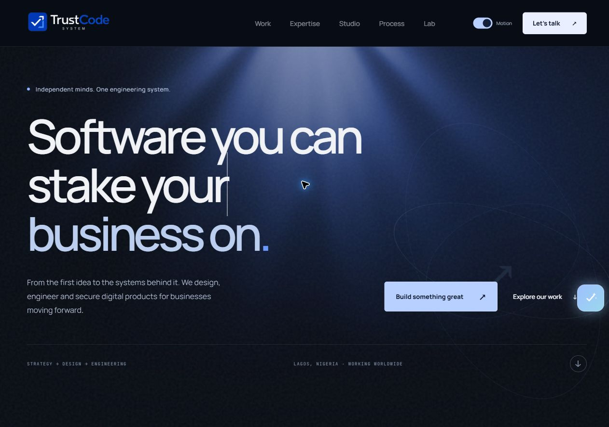
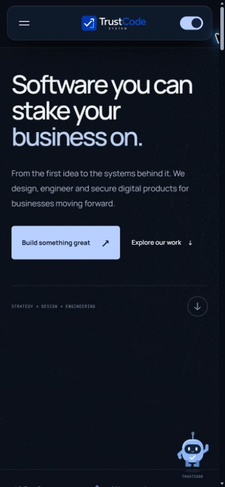
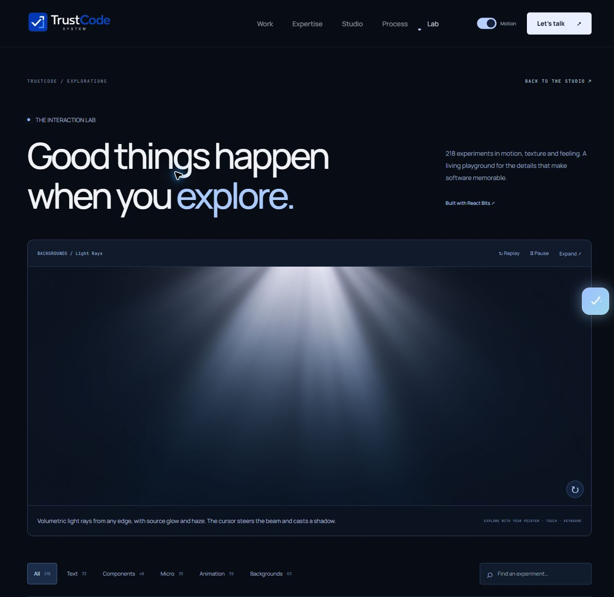

# Redesign validation — 25 October 2026

- TypeScript: passed.
- ESLint: passed, no errors or warnings in the application/adapters. The separately vendored upstream source is excluded and documented.
- Existing Vitest suite: 22 tests passed (15 portfolio/content tests, 7 contact API tests). Email delivery is mocked in the API tests; no test enquiry was sent externally.
- Optimized production build: passed, with 44 generated pages.
- React Bits startup sweep in Edge against the optimized local build: **218 / 218 mounted, 0 startup errors, 0 timeouts**. Evidence: [runtime records](verification/react-bits-runtime-check.json).
- The Three model viewer was separately inspected visually after renderer alignment and rendered the local sample model. Soft Aurora also passed the production sweep.
- After the upstream CodeQL integration patches, Galaxy, CircularGallery and Shuffle were rechecked in the final optimized build. The starfield and gallery rendered visibly, Shuffle mounted, and no browser errors were recorded. Evidence: [targeted rechecks](verification/react-bits-patch-rechecks.json).
- Main navigation, expertise selection, service-to-contact prefill, work search/category filtering, search empty states/reset, lab filtering/search/replay, contact first-stage validation, preserved choices when navigating back, mobile navigation and Escape dismissal were exercised in Edge.
- Home layouts were checked at 320 px, 390 px and the normal desktop viewport. Mobile home, lab and contact had no horizontal overflow in the checked states. This is responsive sampling, not a claim of exhaustive device/browser coverage.
- Paused-motion mode preserves the text and final statistics. Voice experiments use simulated input; the reflective-card adapter does not enable a webcam.

The sequential runtime check waits for the experiment loader to clear, then observes a 1.5-second settling interval. It detects initial mounting and asynchronous errors during that window. It does **not** certify every interaction, visual state, late asset failure, browser, device, GPU or sustained frame rate. The site has on-demand effects and per-experiment error boundaries for capability differences.

## Visual evidence

